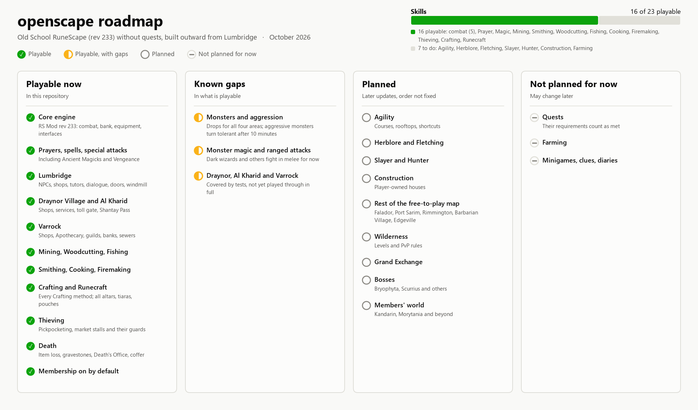

# openscape

An open source Old School RuneScape server for **revision 233**, built on
[RS Mod](https://github.com/rsmod/rsmod). The goal is the game as it plays in OSRS, numbers taken from
the OSRS Wiki, without quests: anything a quest would unlock works as if the quest is done.

Content is built outward from Lumbridge. Membership is on for every account.



## What works today

- **Lumbridge, Draynor Village, Al Kharid and Varrock**: NPCs, shops, services, dialogue, doors,
  banks, every attackable monster with its drop table.
- **Monsters**: the ones the OSRS Wiki calls aggressive attack players up to twice their combat
  level, and turn tolerant after 10 minutes in the same area.
- **Skills**: combat (Attack, Strength, Defence, Ranged, Hitpoints), Prayer, Magic, Mining, Smithing,
  Crafting, Woodcutting, Fishing, Cooking, Firemaking, Runecraft and Thieving (pickpocketing and
  market stalls).
- **Combat**: prayers, the standard and Ancient spellbooks, Vengeance, special attacks.
- **Death**: item loss, gravestones, Death's Office and Death's Coffer.

Known gaps: monsters that cast spells or shoot (dark wizards, for one) fight in melee for now.

## Setting it up

You need **Java 21** ([Adoptium](https://adoptium.net/temurin/releases/?version=21) works) and Git.
Building takes a few GB of memory; on a machine with 8 GB, close other programs first.

```sh
git clone https://github.com/sixk-tagged/openscape.git
cd openscape
./gradlew install --console=plain    # Windows: gradlew.bat install --console=plain
./gradlew run --console=plain
```

`install` runs once. It downloads the rev 233 game cache, packs the server's cache from it (this
takes several minutes) and creates the server's key pair in `.data/`. The server is ready when the
log says `Bound to ports: 43594`.

IntelliJ IDEA works too: open the folder, load the Gradle project and run the `GameServer`
configuration (screenshots of each step are in [docs/images](docs/images)).

### Connecting

Use [RSProx](https://github.com/blurite/rsprox) (a RuneLite-based client for private servers). Add
this target to `~/.rsprox/proxy-targets.yaml` (Windows: `C:\Users\<you>\.rsprox\proxy-targets.yaml`):

```yaml
config:
  - name: openscape
    jav_config_url: https://client.blurite.io/jav_local_233.ws
    revision: 233
    modulus: <the Modulus line from .data/client.key>
    runelite_bootstrap_commithash: cea91b9921a3647683ba8a5c22ec75c752c91b07
```

Start RSProx, pick `openscape` and log in with any username. The first login creates the account.

### Realms

`.data/server.toml` (written on the first start) picks the realm:

| Realm | For | Admin commands | Passwords | XP rate |
|---|---|---|---|---|
| `dev` (default) | testing on your own machine | every account | ignored | 150x |
| `main` | a server other people play on | none | checked | 1x |

```toml
realm = 'main'
world = 1
first_launch = false
```

Each realm keeps its own characters. Don't let other people play on `dev`: every account there is an
admin. On `main`, the first login with a new name creates that account with the password typed.

Others connecting from outside your network need TCP port 43594 open, and a client config whose world
list points at your address instead of `127.0.0.1`. Keep `.data/game.key` private: it is the
server's private key. Players only ever need the modulus from `client.key`.

## Working on it

| Command | What it does |
|---|---|
| `./gradlew run` | Starts the server |
| `./gradlew packCache` | Repacks the server cache. Run it after changing types, symbols or the map, and before integration tests (they hang without it) |
| `./gradlew test` | Unit tests |
| `./gradlew :content:skills:mining:integration` | One module's integration tests (game simulation) |
| `./gradlew :server:shared:integration` | Starts every script together and fails if two handle the same event, which would stop the server from booting |
| `./gradlew spotlessApply` | Formats the code (CI checks it) |

Saves live in `.data/saves/game.db` (SQLite). Back that file up if the server holds anything you care
about.

## Credits and license

openscape is a fork of [RS Mod](https://github.com/rsmod/rsmod) and keeps its
[ISC license](LICENSE.md). Thanks to the RS Mod contributors, to
[RSProx](https://github.com/blurite/rsprox) and Blurite for the client, and to the
[OSRS Wiki](https://oldschool.runescape.wiki/) for the data.

openscape is a fan project, not affiliated with or endorsed by Jagex. Old School RuneScape and
RuneScape are trademarks of Jagex Ltd.
